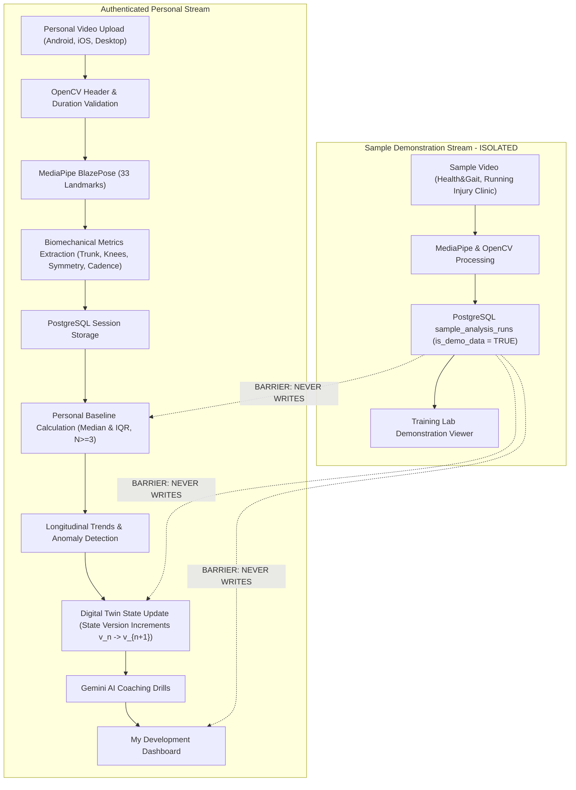
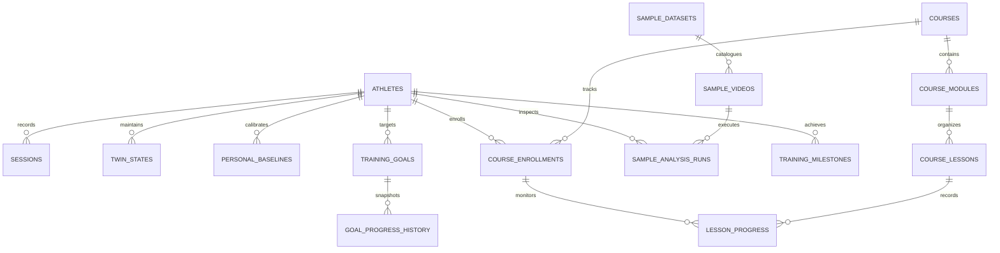

# Personal Sports Digital Twin — Training Feature Architecture

**Project:** Personal Sports Digital Twin  
**GitHub Repository:** [https://github.com/Prasad-9955/Personal-sports-digital-twin](https://github.com/Prasad-9955/Personal-sports-digital-twin)  
**Live Frontend:** [https://personal-sports-digital-twin.vercel.app](https://personal-sports-digital-twin.vercel.app)  
**Live Backend:** [https://personal-sports-digital-twin.onrender.com](https://personal-sports-digital-twin.onrender.com)  
**Architecture Date:** November 9, 2026  

---

## 1. Product Vision: Learn → Practice → Improve

The platform is designed around the athletic development cycle:
1. **LEARN**: Sports science curriculum via the **Training Academy**, with video lectures, posture guides, and knowledge evaluations.
2. **PRACTICE**: Video exploration in the **Training Lab**, analyzing technique benchmarks from public datasets and capturing personal running videos on mobile or desktop devices.
3. **IMPROVE**: Continuous longitudinal monitoring via **My Development** and the **Digital Twin**, tracking empirical kinematic deltas against personalized statistical baselines.

---

## 2. Strict Digital Twin Isolation Architecture

A core scientific requirement of the platform is the **absolute separation** between demonstration benchmark data and authenticated athlete personal twin states.

### Data Isolation Rules
1. `SampleAnalysisRun` records are strictly marked with `is_demo_data = True`.
2. Sample analysis runs **never** trigger `baseline_service.calculate_athlete_baselines`.
3. Sample analysis runs **never** increment `twin_states.state_version`.
4. Academic course progress and quiz completion are decoupled from biomechanical mastery metrics.

---

## 3. Database Schema & Relational Model

### Table Definitions

| Table | Module | Purpose |
| :--- | :--- | :--- |
| `sample_datasets` | Training Lab | Catalogues public research databases (Health&Gait, Running Injury Clinic) with licensing and citations |
| `sample_videos` | Training Lab | Curated benchmark videos across 5 categories and 4 camera angles |
| `sample_analysis_runs` | Training Lab | Execution records of MediaPipe analysis on samples (`is_demo_data = TRUE`) |
| `courses` | Training Academy | 3 curriculum levels (Beginner, Intermediate, Advanced) |
| `course_modules` | Training Academy | Structural subdivisions of courses |
| `course_lessons` | Training Academy | Units supporting 6 formats: `VIDEO`, `TEXT`, `DEMO`, `PRACTICAL`, `QUIZ`, `ASSIGNMENT` |
| `course_enrollments` | Training Academy | Athlete enrolment status and cumulative progress percentage |
| `lesson_progress` | Training Academy | Lesson completion state and quiz grading scores |
| `goal_progress_history` | Development | Chronological progress snapshots as sessions are recorded |
| `training_milestones` | Timeline | Milestone events across enrolments, completions, uploads, and baselines |

---

## 4. Public Dataset Sources & Licensing

| Dataset Name | Primary Provider | Provenance & Format | License Type | Usage in Platform |
| :--- | :--- | :--- | :--- | :--- |
| **Health&Gait Open Biomechanical Dataset** | Open Science Framework / Biomechanics Research Group | 1080p MP4 sagittal & frontal recordings of healthy adult distance runners | Creative Commons Attribution 4.0 International (CC-BY 4.0) | Benchmark running form, cadence consistency, and multi-angle projections |
| **Running Injury Clinic Kinematic Dataset** | University of Calgary Sport Technology Group | High-speed 2D sagittal treadmill protocols with ground reaction force data | Open Data Commons Attribution License (ODC-By v1.0) | Benchmark joint range of motion, knee flexion symmetry, and forward lean angles |

---

## 5. API Endpoint Specifications

### Training Lab
- `GET /api/v1/training-lab/samples` — Query sample library by category and camera angle.
- `GET /api/v1/training-lab/samples/{sample_id}` — Get single sample video and benchmark metadata.
- `POST /api/v1/training-lab/samples/{sample_id}/analyze` — Run MediaPipe BlazePose pipeline on sample video with isolated demo output.

### Training Academy
- `GET /api/v1/academy/courses` — List courses with active student progress.
- `GET /api/v1/academy/courses/{course_id_or_slug}` — Curriculum hierarchy with lessons and user progress.
- `POST /api/v1/academy/courses/{course_id}/enroll` — Enrol authenticated athlete.
- `GET /api/v1/academy/lessons/{lesson_id}` — Lesson content, video, or quiz items.
- `POST /api/v1/academy/lessons/{lesson_id}/progress` — Update lesson completion and submit quiz answers for automatic scoring.

### Development & Timeline
- `GET /api/v1/development/summary` — Consolidated payload: course donut, goal donut, 6 skill criteria, biomechanical deltas, activity volumes, velocity estimates.
- `GET /api/v1/development/timeline` — Chronological milestone feed filtered by `window=week|month|all`.
